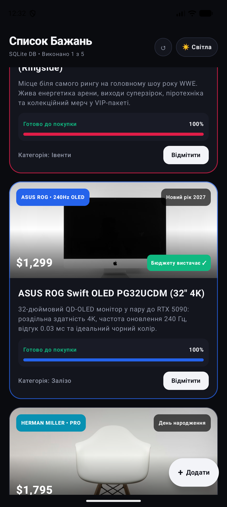
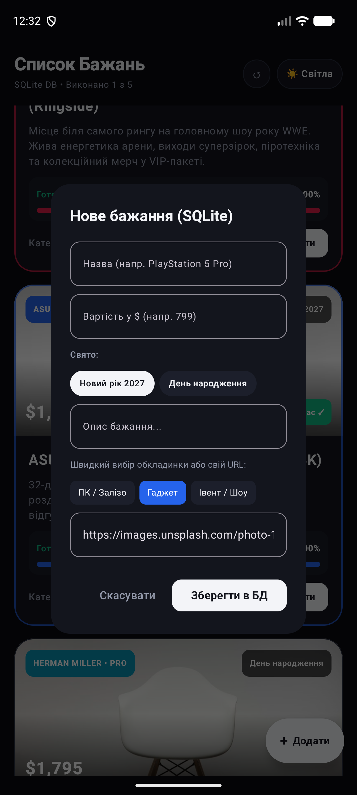
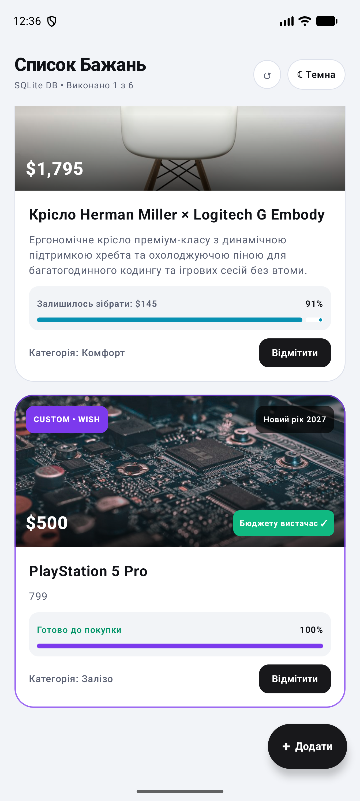
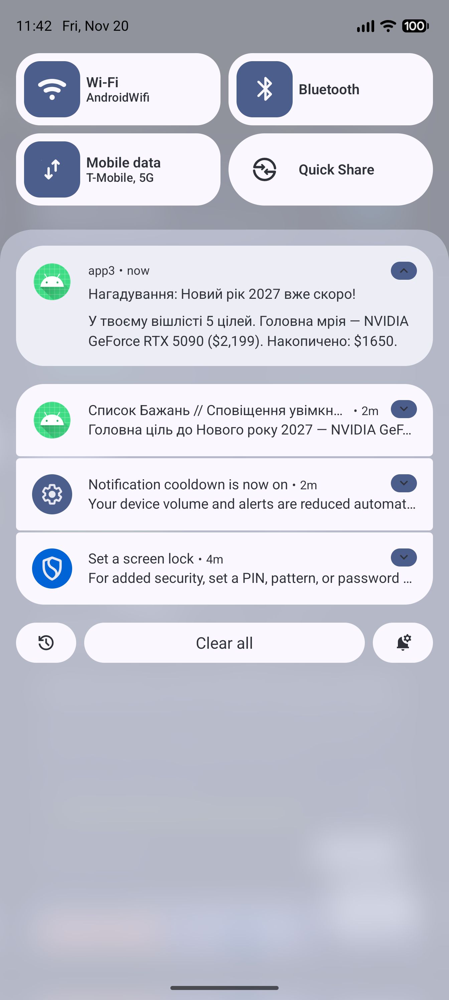

# Практична робота №2 — Додаток «Список Бажань» (WishList) + Системні сповіщення

Повноцінний сучасний Android-додаток для планування та візуалізації списку бажань до найближчих свят (Новий рік, День народження тощо) із кастомною версткою карток, інтерактивною скарбничкою, перемиканням тем, збереженням у базі даних **SQLite** та модулем **системних сповіщень (NotificationChannel, NotificationCompat)**.

---

## 📱 Скріншоти додатку / Screenshots

| 1. Головний екран (Темна тема) | 2. Картки бажань (Прокрутка) | 3. Додавання бажання в БД | 4. Світла тема + Новий пункт | 5. Системне сповіщення |
|:---:|:---:|:---:|:---:|:---:|
|  |  |  |  |  |

---

## 🔔 Системні сповіщення (Практика №2)

У додатку реалізовано повноцінний механізм відправки пуш-повідомлень у системну шторку Android із власним текстом та описом:

1. **Дозвіл у Manifest та Runtime Permission**:
   - У `AndroidManifest.xml` додано `<uses-permission android:name="android.permission.POST_NOTIFICATIONS" />`.
   - Для Android 13+ (API 33+) реалізовано динамічний запит дозволу через `rememberLauncherForActivityResult(ActivityResultContracts.RequestPermission())`.
2. **Канал сповіщень (`NotificationChannel`)**:
   - Ідентифікатор: `wishlist_notifications_channel`.
   - Назва: *«Сповіщення Списку Бажань»*.
   - Рівень важливості: `NotificationManager.IMPORTANCE_HIGH`.
3. **Формування сповіщення (`NotificationCompat.Builder`)**:
   - Кастомний заголовок: *«Нагадування: Новий рік 2027 вже скоро!»*.
   - Кастомний опис: *«У твоєму вішлісті 5 цілей. Головна мрія — NVIDIA GeForce RTX 5090 ($2,199). Накопичено: $1650.»*.
   - Використання стилю `BigTextStyle()` для розгорнутого відображення опису.
4. **Точки виклику**:
   - 🔔 **Кнопка дзвіночка** у верхній панелі додатку (`WishlistTopBar`) для надсилання тестового нагадування.
   - 💾 **Автоматичне сповіщення** під час успішного додавання нового бажання в базу даних SQLite.
   - ✅ **Сповіщення про виконання мети** (*«Мрію здійснено! ✓»*).

---

## ✨ Реалізований функціонал

1. **Кастомна верстка пунктів списку (LazyColumn)**:
   - Якісне асинхронне завантаження обкладинок через **Coil (`AsyncImage`)** із заокругленими кутами.
   - Тематичні бейджі брендів та категорій (*«NVIDIA • 32GB GDDR7»*, *«ANTHROPIC • AI MAX»*, *«WWE • RINGSIDE VIP»*, *«ASUS ROG»*, *«HERMAN MILLER»*, *«CUSTOM • WISH»*).
   - Назва, вартість, детальний опис, мітка свята.
   - **Динамічний індикатор накопичення**: прогрес-бар для кожного бажання показує відсоток зібраних коштів або бейдж *«Бюджету вистачає ✓»* / *«Мрія здійснена!»*.
2. **Банер найближчого свята**:
   - Автоматичний розрахунок днів, що залишилися до події (*«Новий рік 2027»*, *«День народження»*), та кількості запланованих бажань.
3. **Інтерактивна скарбничка (SQLite Wallet)**:
   - Збереження накопиченого бюджету локально в БД.
   - Кнопка швидкого поповнення скарбнички (*+ $250*).
   - Підрахунок покриття суми бажань у відсотках.
4. **Фільтрація за категоріями та святами**:
   - Швидкі таби: *«Усі свята»*, *«Новий рік 2027»*, *«День народження»*, *«Виконані»*.
5. **Діалогове вікно додавання бажання (`NewWishDialog`)**:
   - Введення назви, вартості в $, категорії, вибір свята та опис.
   - Швидкий вибір готових пресетів обкладинок або введення власного URL.
   - Миттєвий запис об'єкта в базу даних SQLite.
6. **Керування та деталі**:
   - Натискання на картку відкриває модальне вікно з можливістю позначити бажання як виконане або видалити його з SQLite.
7. **Теми оформлення (Dark & Light Theme)**:
   - Повноцінна підтримка глибокої тёмної (OLED Dark) та чистої світлої палітри з перемикачем у верхній панелі.

---

## 🗄️ Порівняння варіантів локального збереження в SQLite (до захисту)

Під час виконання роботи було досліджено два ключові підходи до збереження даних на платформі Android:

### 1. Нативний `SQLiteOpenHelper` (Використано в проєкті)
- **Як реалізовано**: створено клас `WishlistDbHelper : SQLiteOpenHelper`, який інкапсулює створення структури БД, початкове наповнення даними (seeding) та операції CRUD.
- **Таблиці в БД**:
  - `wishes` — зберігає id, назву, бейдж бренду, категорію, свято, вартість (USD), опис, посилання на зображення, акцентний колір та статус виконання.
  - `wallet_state` — зберігає поточний стан накопичень у скарбничці.
- **Переваги (Плюси)**:
  - Працює «з коробки» у складі Android SDK без підключення важких плагінів кодогенерації (`kapt` або `ksp`).
  - Мінімальний розмір APK та нульовий оверхед часу білду.
  - Повний і прямий контроль над SQL-запитами, транзакціями, оптимізаціями та міграціями версій схем (`onCreate`, `onUpgrade`).
- **Недоліки (Мінуси)**:
  - Необхідність написання рутинного шаблонного коду (робота з `ContentValues`, ручне читання колонок із `Cursor`).
  - Відсутність перевірки синтаксису SQL-запитів на етапі компіляції.

### 2. Jetpack Room (ORM-надбудова над SQLite)
- **Принцип роботи**: офіційна бібліотека від Google, яка абстрагує рутинну роботу з SQLite через анотації `@Entity`, `@Dao`, `@Database`.
- **Переваги (Плюси)**:
  - Валідація синтаксису SQL-запитів на етапі компіляції програми (помилки в назві стовпчиків виявляються до запуску).
  - Нативна реактивна інтеграція з асинхронними потоками Kotlin (`Flow`, `StateFlow`) та `LiveData`.
  - Зручне автоматичне генерування міграцій схеми та спрощена робота з реляційними зв'язками (`@Relation`, `@ForeignKey`).
- **Недоліки (Мінуси)**:
  - Потребує налаштування процесорів анотацій (KSP), що збільшує час повної збірки проєкту.

---

## 🛠 Технологічний стек

- **Мова програмування**: Kotlin 2.0+
- **UI Framework**: Jetpack Compose (Declarative Reactive UI) & Material 3
- **База даних**: SQLite (через `SQLiteOpenHelper`, `SQLiteDatabase`, `Cursor`, `ContentValues`)
- **Сповіщення**: `NotificationManagerCompat`, `NotificationChannel`, `NotificationCompat`
- **Завантаження зображень**: Coil 2.7.0 (`coil-compose`)
- **Архітектура**: Single Activity, State Management via Compose Runtime
- **Цільова платформа**: Android SDK 33+ (compileSdk 37)

---

## 💻 Інструкція із запуску

1. Склонуйте репозиторій:
   ```bash
   git clone https://github.com/LANCER477/Android_2.git
   ```
2. Відкрийте проєкт у **Android Studio** (Ladybug / Koala / Meerkat або новішої версії).
3. Дочекайтеся автоматичної синхронізації Gradle.
4. Запустіть застосунок на емуляторі або підключеному фізичному Android-пристрої.
