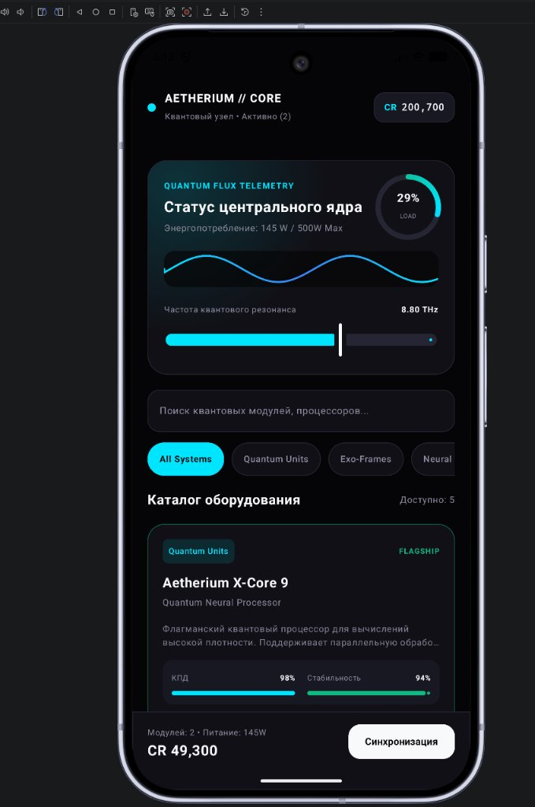
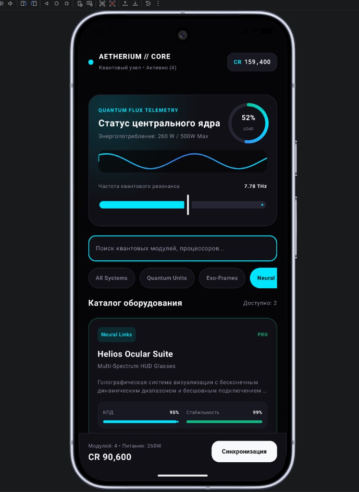
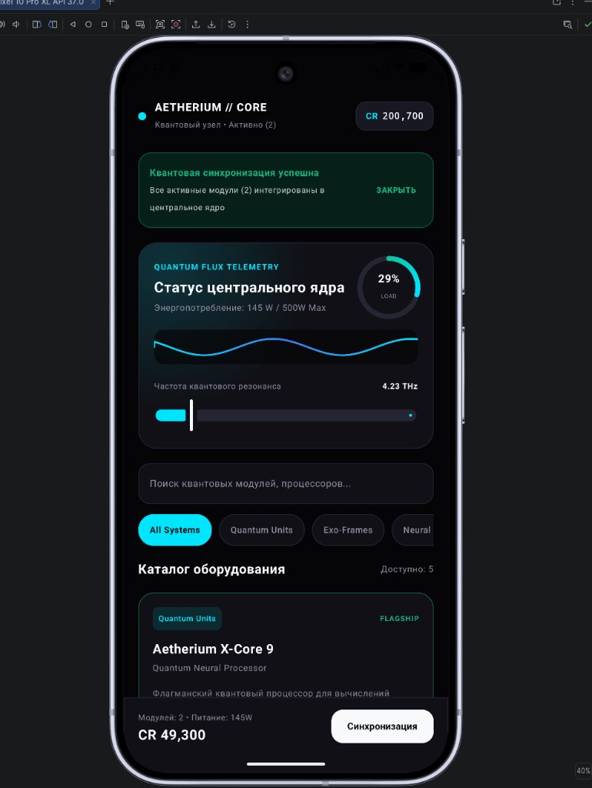

# Aetherium // Core — Quantum Flux Telemetry Dashboard

Futuristic Cyberpunk / Sci-Fi Android Dashboard & Equipment Catalog built with **Jetpack Compose** & **Material 3**.

---

## 📱 Скріншоти додатку / Screenshots

| Головний екран & Телеметрія | Фільтрація за категоріями | Квантова синхронізація |
|:---:|:---:|:---:|
|  |  |  |

---

## 🚀 Про проєкт

Проєкт розроблено в рамках домашнього завдання з розробки під Android. Додаток представляє собою футуристичний інтерфейс управління квантовим вузлом (Cyberpunk / Sci-Fi UI) з динамічною телеметрією, каталогом високотехнологічного обладнання та інтерактивними елементами керування.

### ✨ Ключові можливості:
- **Quantum Flux Telemetry**:
  - Візуалізація квантової хвилі в реальному часі на кастомному **Jetpack Compose Canvas** з гармонічними коливаннями.
  - Індикатор завантаження ядра з круговою діаграмою (Circular Progress).
  - Інтерактивний слайдер регулювання частоти квантового резонансу (THz).
  - Розрахунок енергоспоживання (W) в залежності від частоти та підключених модулів.
- **Пошук та фільтрація**:
  - Живий пошук квантових процесорів, екзо-систем та нейроінтерфейсів за назвою та описом.
  - Фільтри категорій (*All Systems*, *Quantum Units*, *Exo-Frames*, *Neural*).
- **Каталог квантового обладнання**:
  - Інтерактивні картки з бейджами рівня (*FLAGSHIP*, *MILITARY*, *PRO*).
  - Візуальні індикатори ККД (Efficiency) та термічної стабільності.
  - Підключення/відключення модулів із динамічним перерахунком сумарної вартості (CR) та енергоспоживання.
- **Детальне модальне вікно (Modal Dialog)**:
  - Перегляд повних специфікацій (тактова частота, охолодження, архітектура тощо) та детального опису.
- **Панель швидкої синхронізації (Bottom Dock)**:
  - Підсумок підключених модулів та вартості в кредитах (CR).
  - Кнопка **«Синхронізація»** з анімованим банером успішної інтеграції модулів у ядро.

---

## 🛠 Технологічний стек

- **Мова програмування**: Kotlin 2.0+
- **UI Framework**: Jetpack Compose & Material 3
- **Графіка та анімації**: Canvas API, Compose Animation (`animateFloatAsState`, `rememberInfiniteTransition`, `AnimatedVisibility`)
- **Архітектура**: Single Activity, State-driven Reactive UI
- **Цільова платформа**: Android SDK 33+ (compileSdk 37)

---

## 💻 Інструкція із запуску

1. Склонуйте репозиторій:
   ```bash
   git clone https://github.com/LANCER477/Android_2.git
   ```
2. Відкрийте проєкт у **Android Studio** (Ladybug / Koala / Meerkat або новішій версії).
3. Дочекайтеся завершення синхронізації Gradle.
4. Запустіть проєкт на фізичному пристрої або емуляторі Android (рекомендовано API 33+).
